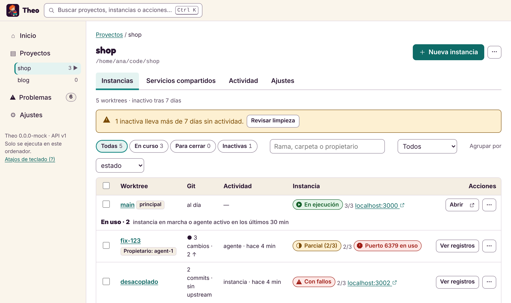
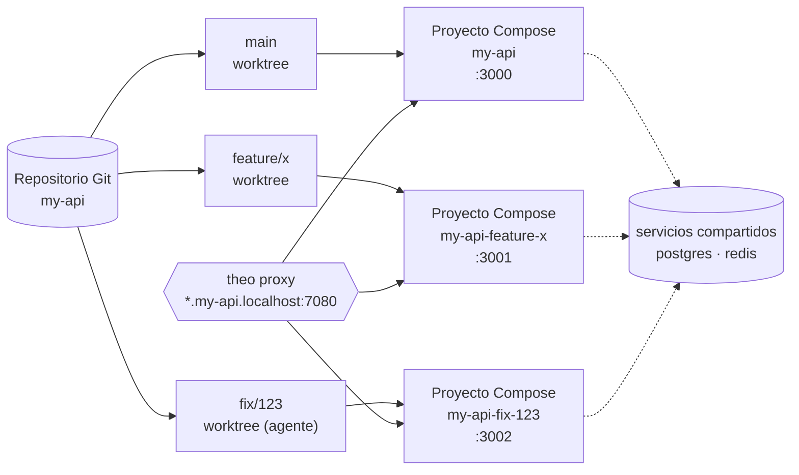
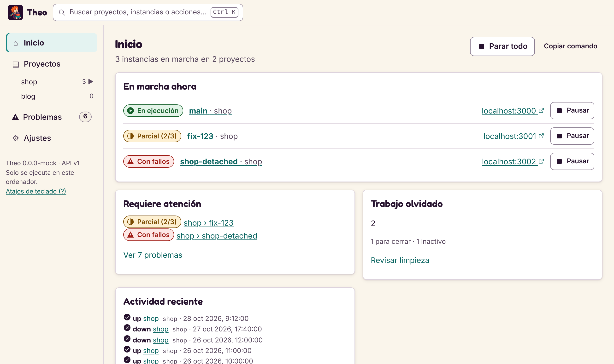

<div align="center">


[English](README.md) · **Español**

# Theo

**Un proyecto, muchas ramas, todas en marcha a la vez.**

Theo da a cada worktree de Git su propio entorno de Docker Compose, para que tú, o varios agentes de IA, trabajéis en funcionalidades distintas a la vez sin pelearos por puertos, contenedores ni datos.

[](https://github.com/ElMaxter99/Theo/actions/workflows/ci.yml)
[](https://github.com/ElMaxter99/Theo/releases/latest)
[](go.mod)
[](#notas-por-plataforma)
[](docs/cli/mcp.md)
[](LICENSE)

[Instalación](#instalación) · [Inicio rápido](#inicio-rápido) · [Novedades](#novedades) · [Comandos](#comandos) · [Interfaz](#interfaz-web-y-de-escritorio) · [Agentes de IA](#agentes-de-ia-mcp) · [Changelog](CHANGELOG.md)

</div>

<picture>
  <source media="(prefers-color-scheme: dark)" srcset="docs/images/ui-instances-dark-es.png">
  
</picture>

> La documentación detallada de [`docs/`](docs/cli/quickstart.md), los mensajes de commit y las issues están en inglés. Este README es la puerta de entrada en español.

## Por qué Theo

- 🌳 **Una copia en marcha por rama.** `theo worktree add` y `theo up` dan a cada rama su propio proyecto de Compose, contenedores, volúmenes y puertos. Tu checkout principal sigue funcionando.
- 🔌 **Sin choques de puertos.** `--auto-ports` elige puertos libres y `theo proxy` sirve cada instancia en `http://<servicio>.<instancia>.<proyecto>.localhost:7080`, con HTTPS local opcional.
- 🤝 **Comparte lo que deba compartirse.** Una sola base de datos o caché para todos los worktrees, o una por rama; lo eliges por servicio.
- 🧹 **Nada olvidado.** Cada worktree tiene un estado (`merged`, `inactive`, `unpushed`, `in-use`...). `theo worktree clean` cierra los terminados, `park` aparca el trabajo a medias y `keep` protege una demo.
- 🤖 **Pensado para agentes.** `theo mcp` permite a Claude Code y a otros clientes MCP crear un worktree, arrancarlo, leer sus registros y cerrarlo cuando su rama se fusiona.
- 🛡️ **Seguro por defecto.** Tus archivos de Compose y tu `.env` no se tocan nunca, `down` nunca borra volúmenes y todo lo que borra datos pide una confirmación escrita.
- 🖥️ **Línea de comandos, web y escritorio.** El mismo motor local detrás de `theo`, `theo ui` y la aplicación `theo-desktop`, en inglés o en español.

## Cómo funciona



Theo maneja el `git` y el `docker compose` que ya tienes. Escribe sus propios archivos generados por instancia, fuera de tu proyecto, y guarda su registro en su directorio de datos.

## Instalación

| Cómo | Comando |
|---|---|
| **Binarios de la versión** | Descarga el archivo de tu sistema desde la [página de versiones](https://github.com/ElMaxter99/Theo/releases) (`tar.gz` para Linux y macOS, `zip` para Windows, amd64 y arm64), compruébalo con `checksums.txt` y pon `theo` en tu `PATH`. |
| **Scoop** (Windows) | `scoop install https://github.com/ElMaxter99/Theo/releases/latest/download/theo.json` |
| **Homebrew** (macOS, Linux) | Cada versión adjunta `theo.rb`, una fórmula para un tap propio; todavía no hay un tap público. |
| **Go** 1.24+ | `go install github.com/ElMaxter99/Theo/cmd/theo@latest` |
| **Desde el código** | `git clone https://github.com/ElMaxter99/Theo && cd Theo && go build ./cmd/theo` (o `scripts/build.sh`, `scripts/build.ps1`) |

También necesitas **Git** y **Docker con el plugin de Compose** en tu `PATH`. Leer los servicios de un proyecto ejecuta `docker compose config`, que no necesita el demonio; arrancar e inspeccionar contenedores sí. `theo doctor` lo comprueba todo de una vez.

## Inicio rápido

```sh
theo project add ~/code/my-api --name my-api    # registra un repositorio Git
theo services my-api                            # qué va a ejecutar Compose
theo up my-api                                  # arranca el worktree principal

theo worktree add my-api feature/x --new        # un segundo worktree
theo up my-api -w feature/x --auto-ports        # en marcha junto al primero
theo ps my-api
theo open my-api -w feature/x web               # abre su servicio web en el navegador

theo down my-api -w feature/x                   # lo para; los volúmenes se quedan
```

Dentro de una carpeta del proyecto puedes omitir el proyecto (o escribir `.`). `theo` a secas muestra un resumen de todos los proyectos y del trabajo que puedes haber olvidado.

Más en el [quickstart](docs/cli/quickstart.md) (en inglés). Para probarlo todo con una aplicación pequeña hecha para ello, sigue [`examples/demo`](examples/demo/README.md).

## Novedades

### v0.4: trabajo olvidado

```sh
theo worktrees my-api                          # ESTADO y ACTIVIDAD de cada worktree
theo worktree clean my-api                     # qué se podría cerrar; no cambia nada
theo worktree clean my-api --confirm my-api    # cierra los fusionados y los que ya no existen
theo worktree park my-api old-spike --note "esperando a la API"
theo worktree resume my-api old-spike
theo worktree keep my-api demo --until 2026-12-01 --note "demo para el cliente"
```

Listar es rápido incluso con 50 worktrees en Windows (Git y Docker se consultan en paralelo) y la consola de Windows muestra ASCII simple en lugar de símbolos rotos (`THEO_ASCII=0` lo desactiva).

Detecta las ramas fusionadas incluso tras un squash o un rebase en GitHub. Las ramas remotas y los volúmenes no se tocan nunca. Los agentes pueden cerrar su propio worktree con la herramienta MCP `finish_worktree`. Ver [forgotten work](docs/cli/worktrees.md#forgotten-work-states-clean-park-resume-keep).

### Versiones anteriores

- **v0.3:** HTTPS local para los dominios locales (`theo proxy --https`, `theo proxy trust`), notificaciones de progreso en MCP y `wait_for`, y un aviso cuando una aplicación guarda su dirección antigua en sus datos (WordPress, Ghost, Nextcloud...).
- **v0.2:** la interfaz rediseñada con paleta de comandos, el servidor MCP, el proxy local, la detección del motor de contenedores (Docker Desktop, Colima, OrbStack, Podman...), la interfaz en español, `theo open` y `theo stop --all`.

Todo está en el [changelog](CHANGELOG.md) (en inglés).

## Comandos

`theo help` muestra la lista completa y `theo help <comando>` uno concreto. Todo comando que muestra datos admite `--json`.

| Tema | Comandos | Página |
|---|---|---|
| Inicio rápido | lo básico, paso a paso | [quickstart](docs/cli/quickstart.md) |
| Proyectos | `project add\|set\|list\|remove` | [project](docs/cli/project.md) |
| Archivos de Compose | qué archivos y archivos env se usan | [compose-files](docs/cli/compose-files.md) |
| Worktrees | `worktrees`, `branches`, `worktree add\|remove`, `up`, `down`, `restart`, `stop`, `ps`, `logs`, `open` | [worktrees](docs/cli/worktrees.md) |
| Trabajo olvidado | `worktree clean\|park\|resume\|keep\|base` | [worktrees](docs/cli/worktrees.md#forgotten-work-states-clean-park-resume-keep) |
| Puertos | `ports`, `up --auto-ports` | [ports](docs/cli/ports.md) |
| Dominios locales | `proxy`, `proxy routes`, `proxy --https`, `proxy trust` | [proxy](docs/cli/proxy.md) |
| Ajustes por instancia | `env set\|unset\|list`, `instance set\|show\|config`, `history` | [instance-settings](docs/cli/instance-settings.md) |
| Volúmenes | `volumes`, `volumes purge\|backup\|restore\|clone` | [volumes](docs/cli/volumes.md) |
| Servicios compartidos | `shared add\|use\|up\|status\|down` | [shared](docs/cli/shared.md) |
| Estado | `status` | [status](docs/cli/status.md) |
| Explicar | `explain` | [explain](docs/cli/explain.md) |
| Reconciliar | `reconcile` | [reconcile](docs/cli/reconcile.md) |
| Diagnóstico y motores | `doctor`, `THEO_DOCKER` | [doctor](docs/cli/doctor.md), [engines](docs/cli/engines.md) |
| Autocompletado | `completion` | [completion](docs/cli/completion.md) |
| Formatos de salida | `--json`, `--color` y compañía | [output](docs/cli/output.md) |
| Compatibilidad con Compose | funciones de Compose admitidas y límites | [compose-compat](docs/cli/compose-compat.md) |
| Precedencia de variables | qué valor gana | [env-precedence](docs/cli/env-precedence.md) |
| Interfaz web | `ui`, `serve` | [ui](docs/cli/ui.md), [pantallas](docs/cli/ui-web.md) |
| Aplicación de escritorio | la misma interfaz en una ventana nativa (`theo-desktop`) | [desktop](docs/cli/desktop.md) |
| Agentes de IA (MCP) | `mcp [--read-only] [--owner <nombre>]`, `mcp install` | [mcp](docs/cli/mcp.md) |

## Interfaz web y de escritorio

`theo ui` abre una interfaz local en tu navegador; `theo-desktop` muestra la misma en una ventana nativa. El inicio enseña lo que está en marcha, lo que necesita atención y el trabajo olvidado; cada proyecto lista sus worktrees por estado, con Arrancar, Pausar, Aparcar, Conservar y Reanudar a un clic. Pulsa <kbd>Ctrl</kbd>+<kbd>K</kbd> (<kbd>⌘</kbd>+<kbd>K</kbd>) para abrir la paleta de comandos.

<picture>
  <source media="(prefers-color-scheme: dark)" srcset="docs/images/ui-home-dark-es.png">
  
</picture>

Solo escucha en este ordenador y sigue el idioma del navegador (inglés o español), con un selector en Ajustes. Ver [ui](docs/cli/ui.md) y [desktop](docs/cli/desktop.md).

## Agentes de IA (MCP)

```sh
theo mcp install            # muestra el comando que registra Theo en Claude Code
theo mcp install --apply    # o lo ejecuta
```

Cada agente tiene su propio worktree e instancia, etiquetados con su propietario; puede esperar a que una instancia esté lista (`wait_for`) y cerrar su worktree cuando su rama se fusiona (`finish_worktree`). Las operaciones que borran datos quedan solo para personas, y `--read-only` sirve únicamente las herramientas que no cambian nada. `theo mcp install` también imprime un párrafo para tu `AGENTS.md` o `CLAUDE.md`. Ver [mcp](docs/cli/mcp.md).

## Principios de seguridad

- **Orquestar, no reimplementar.** Theo maneja el `git` y el `docker compose` que ya usas y se apoya en su validación.
- **Nunca toca tus archivos.** Tus archivos de Compose y tu `.env` se quedan como están; Theo escribe sus propios archivos generados por instancia, fuera del proyecto. Los archivos ignorados nunca se copian ni se sobrescriben.
- **Nada se borra de forma implícita.** `down` nunca borra volúmenes. Borrar volúmenes, worktrees o datos es un comando aparte que dice qué va a borrar y pide una confirmación explícita. Los volúmenes declarados `external` y los de otras instancias no se tocan nunca.
- **Primero informar, luego reparar.** `reconcile` y `worktree clean` solo informan; `--apply` o `--confirm` actúan, y `reconcile --apply` solo olvida los registros obsoletos del propio Theo.
- **Los secretos se enmascaran, no se cifran.** Los valores guardados con `theo env --secret` se enmascaran en la salida de Theo, pero se guardan en texto plano en sus archivos de datos, legibles solo por tu usuario. Pasar un secreto por la línea de comandos lo deja en el historial de tu shell.
- **Primero el motor local.** Toda la lógica está en un motor local que comparten la línea de comandos, la interfaz y el servidor MCP.

Theo guarda su registro y sus datos en `theo/` dentro de tu directorio de configuración de usuario (`~/.config` en Linux, `~/Library/Application Support` en macOS, `%AppData%` en Windows). Con `THEO_HOME` puedes usar otro directorio.

## Notas por plataforma

| Plataforma | Estado |
|---|---|
| **Linux** | Plataforma de referencia. La CI ejecuta las pruebas con Docker y la batería de humo contra un demonio de Docker real. |
| **Windows** | La salida de la consola es ASCII simple, así que Windows PowerShell 5.1 no muestra caracteres rotos. La CI compila y ejecuta las pruebas que no necesitan Docker; las pruebas con Docker también pasan a mano con Docker Desktop (WSL 2, contenedores Linux). Se admiten rutas con espacios y acentos. |
| **macOS** | La CI compila y ejecuta las pruebas que no necesitan Docker. Lo que arranca contenedores no está verificado ahí; si encuentras problemas, avísanos. |

- Colima, OrbStack, Rancher Desktop (modo dockerd) y Podman (la CLI de Docker sobre el socket de Podman) deberían funcionar, pero no están probados; `theo doctor` dice qué motor usas y en qué se diferencia. Ver [engines](docs/cli/engines.md).
- `--auto-ports` y los ajustes por instancia necesitan Docker Compose 2.24.4 o posterior.
- Theo es joven: lo descrito funciona y está probado, pero puede haber asperezas. Si encuentras una, [abre una issue](https://github.com/ElMaxter99/Theo/issues/new/choose).

## Desarrollo

```sh
gofmt -l .          # no debe imprimir nada
go vet ./...
go test ./...
```

Las pruebas que usan Git y Docker se saltan solas si faltan; construyen imágenes pequeñas, y la prueba de la guía `examples/demo` descarga `golang`, `alpine` y `redis`. En [CONTRIBUTING.md](CONTRIBUTING.md) están la estructura, las reglas y cómo se publica una versión; en [docs/testing.md](docs/testing.md), cada tipo de prueba; en [SECURITY.md](SECURITY.md), cómo informar de una vulnerabilidad, y en [CODE_OF_CONDUCT.md](CODE_OF_CONDUCT.md), el código de conducta. `scripts/build.sh` y `scripts/build.ps1` compilan para el sistema actual o para todos los destinos de la versión; empujar una etiqueta `v*` compila y publica una versión.

Las contribuciones, issues y pull requests se escriben en inglés.

## Licencia

Theo es software libre bajo la [licencia MIT](LICENSE). Las imágenes de marca (mascota, logotipo, iconos) van aparte, con licencia [CC BY 4.0](https://creativecommons.org/licenses/by/4.0/); ver [el aviso](web/public/brand/NOTICE.md).
