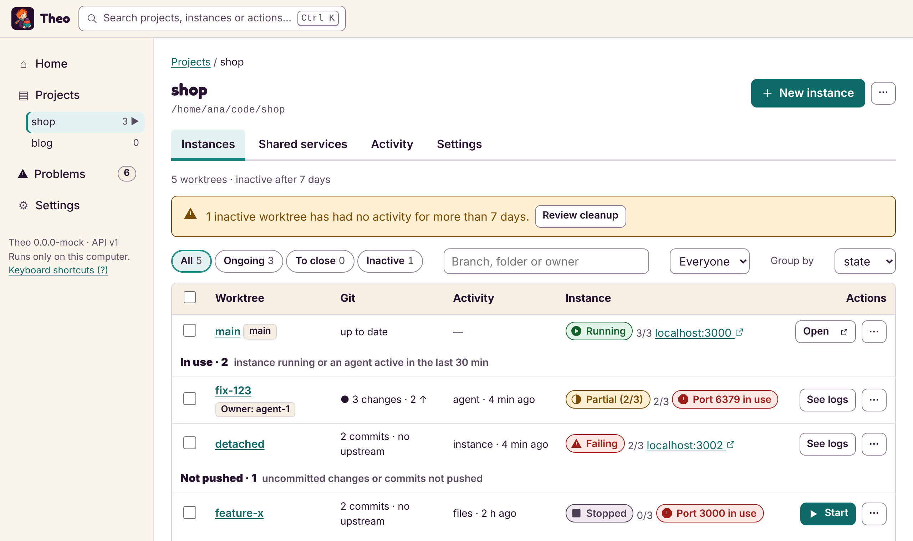
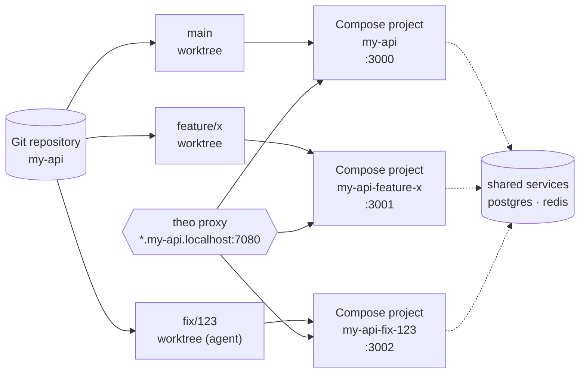
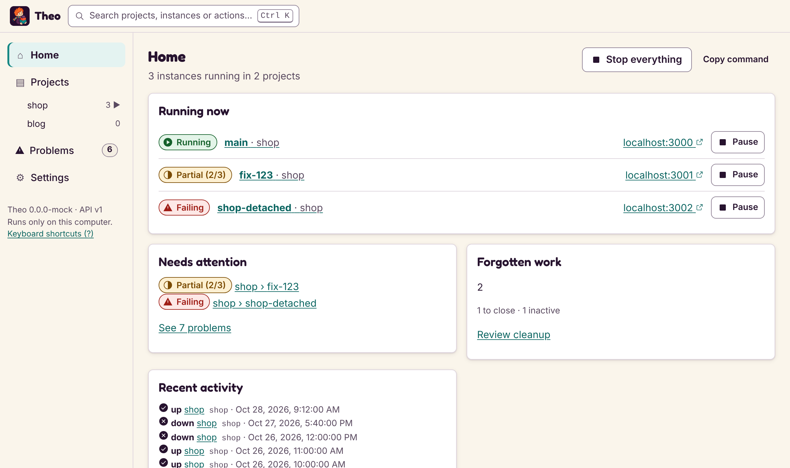

<div align="center">


**English** · [Español](README.es.md)

# Theo

**One project, many branches, all running at once.**

Theo gives every Git worktree its own Docker Compose environment, so you, or several AI agents, can work on different features side by side without fighting over ports, containers or data.

[](https://github.com/ElMaxter99/Theo/actions/workflows/ci.yml)
[](https://github.com/ElMaxter99/Theo/releases/latest)
[](go.mod)
[](#platform-notes)
[](docs/cli/mcp.md)
[](LICENSE)

[Install](#install) · [Quickstart](#quickstart) · [What's new](#whats-new) · [Commands](#commands) · [Interface](#web-and-desktop-interface) · [AI agents](#ai-agents-mcp) · [Changelog](CHANGELOG.md)

</div>

<picture>
  <source media="(prefers-color-scheme: dark)" srcset="docs/images/ui-instances-dark.png">
  
</picture>

## Why Theo

- 🌳 **A running copy per branch.** `theo worktree add` and `theo up` give each branch its own Compose project, containers, volumes and host ports. Your main checkout keeps running.
- 🔌 **No port clashes.** `--auto-ports` picks free host ports, and `theo proxy` serves every instance at `http://<service>.<instance>.<project>.localhost:7080`, with optional local HTTPS.
- 🤝 **Share what should be shared.** Keep one database or cache for every worktree, or isolate it per branch; you choose per service.
- 🧹 **Nothing forgotten.** Every worktree has a state (`merged`, `inactive`, `unpushed`, `in-use`...). `theo worktree clean` closes the finished ones, `park` puts unfinished work away, `keep` protects a demo.
- 🤖 **Built for agents.** `theo mcp` lets Claude Code and other MCP clients create a worktree, start it, read its logs and close it when its branch is merged.
- 🛡️ **Safe by default.** Your Compose files and `.env` are never edited, `down` never removes volumes, and anything that deletes data asks for a typed confirmation.
- 🖥️ **Command line, web and desktop.** The same local engine behind `theo`, `theo ui` and the `theo-desktop` app, in English or Spanish.

## How it works



Theo drives the `git` and `docker compose` you already have. It writes its own generated files per instance, outside your project, and keeps its registry in its data directory.

## Install

| How | Command |
|---|---|
| **Release binaries** | Download the archive for your system from the [releases page](https://github.com/ElMaxter99/Theo/releases) (`tar.gz` for Linux and macOS, `zip` for Windows, amd64 and arm64), check it against `checksums.txt`, and put `theo` in your `PATH`. |
| **Scoop** (Windows) | `scoop install https://github.com/ElMaxter99/Theo/releases/latest/download/theo.json` |
| **Homebrew** (macOS, Linux) | Each release attaches `theo.rb`, a formula for a tap of your own; no public tap is published yet. |
| **Go** 1.24+ | `go install github.com/ElMaxter99/Theo/cmd/theo@latest` |
| **From source** | `git clone https://github.com/ElMaxter99/Theo && cd Theo && go build ./cmd/theo` (or `scripts/build.sh`, `scripts/build.ps1`) |

You also need **Git** and **Docker with the Compose plugin** in your `PATH`. Reading a project's services runs `docker compose config`, which does not need the daemon; starting and inspecting containers does. Run `theo doctor` to check everything at once.

## Quickstart

```sh
theo project add ~/code/my-api --name my-api    # register a Git repository
theo services my-api                            # what Compose will run
theo up my-api                                  # start the main worktree

theo worktree add my-api feature/x --new        # a second worktree
theo up my-api -w feature/x --auto-ports        # run it next to the first
theo ps my-api
theo open my-api -w feature/x web               # open its web service in the browser

theo down my-api -w feature/x                   # stop it; volumes are kept
```

Inside one of the project's folders you can leave the project out (or write `.`). `theo` alone prints a summary of every project and the work you may have forgotten.

More in the [quickstart](docs/cli/quickstart.md). To try everything on a small app made for it, follow [`examples/demo`](examples/demo/README.md).

## What's new

### v0.6: reliability

- `theo doctor` notes what limits free ports per branch (`COMPOSE_FILE`, fixed `container_name`, `${VAR}` in `ports:`), see [ports](docs/cli/ports.md#limits).
- Agent state by process also on macOS and Windows (an estimate; hooks stay the exact source), see [agents](docs/cli/agents.md).
- Branch worktrees use free host ports by default, and Cleanup lets you pick inactive worktrees and remove them.

### v0.5: Theo in the agents' workflow

```sh
theo mcp install --hooks        # Claude Code creates and removes worktrees through Theo
eval "$(theo env)"              # THEO_PORT_WEB, THEO_URL... of this worktree
theo worktree setup my-api feature/x   # run the after_create commands of .theo.json
```

A committed [`.theo.json`](docs/cli/agents.md) says which files a new worktree copies (it reads Claude Code's `.worktreeinclude` too) and which commands to run in it, after you approve them once. Hooks tell Theo whether each agent is working, waiting for you or done. More commands accept `--json`, and `theo doctor` checks more. The "Open in..." menu and the agent badge in the interface are still being designed. See [agents](docs/cli/agents.md).

### v0.4: forgotten work

```sh
theo worktrees my-api                          # STATE and ACTIVITY for every worktree
theo worktree clean my-api                     # what could be closed; changes nothing
theo worktree clean my-api --confirm my-api    # close the merged and missing ones
theo worktree park my-api old-spike --note "waiting for the API"
theo worktree resume my-api old-spike
theo worktree keep my-api demo --until 2026-12-01 --note "client demo"
```

Listing is fast even with 50 worktrees on Windows (Git and Docker are asked in parallel), and the Windows console shows plain ASCII instead of broken symbols (`THEO_ASCII=0` turns that off).

Merged is detected even after a squash or rebase on GitHub. Remote branches and volumes are never touched. Agents can close their own worktree with the MCP tool `finish_worktree`. See [forgotten work](docs/cli/worktrees.md#forgotten-work-states-clean-park-resume-keep).

### Earlier releases

- **v0.3:** local HTTPS for the local domains (`theo proxy --https`, `theo proxy trust`), MCP progress notifications and `wait_for`, and a warning when an app keeps its old address in its data (WordPress, Ghost, Nextcloud...).
- **v0.2:** the redesigned interface with a command palette, the MCP server, the local proxy, container engine detection (Docker Desktop, Colima, OrbStack, Podman...), the Spanish interface, `theo open`, and `theo stop --all`.

Everything is in the [changelog](CHANGELOG.md).

## Commands

Run `theo help` for the full list and `theo help <command>` for one. Every command that prints data supports `--json`.

| Topic | Commands | Page |
|---|---|---|
| Quickstart | the basics, step by step | [quickstart](docs/cli/quickstart.md) |
| Projects | `project add\|set\|list\|remove` | [project](docs/cli/project.md) |
| Compose files | which files and env files are used | [compose-files](docs/cli/compose-files.md) |
| Worktrees | `worktrees`, `branches`, `worktree add\|remove`, `up`, `down`, `restart`, `stop`, `ps`, `logs`, `open` | [worktrees](docs/cli/worktrees.md) |
| Agents | `hook`, `env`, `mcp install --hooks`, `worktree setup`, `.theo.json` | [agents](docs/cli/agents.md) |
| Forgotten work | `worktree clean\|park\|resume\|keep\|base` | [worktrees](docs/cli/worktrees.md#forgotten-work-states-clean-park-resume-keep) |
| Host ports | `ports`, `up --auto-ports` | [ports](docs/cli/ports.md) |
| Local domains | `proxy`, `proxy routes`, `proxy --https`, `proxy trust` | [proxy](docs/cli/proxy.md) |
| Instance settings | `env set\|unset\|list`, `instance set\|show\|config`, `history` | [instance-settings](docs/cli/instance-settings.md) |
| Volumes | `volumes`, `volumes purge\|backup\|restore\|clone` | [volumes](docs/cli/volumes.md) |
| Shared services | `shared add\|use\|up\|status\|down` | [shared](docs/cli/shared.md) |
| Status | `status` | [status](docs/cli/status.md) |
| Explain | `explain` | [explain](docs/cli/explain.md) |
| Reconcile | `reconcile` | [reconcile](docs/cli/reconcile.md) |
| Doctor and engines | `doctor`, `THEO_DOCKER` | [doctor](docs/cli/doctor.md), [engines](docs/cli/engines.md) |
| Shell completion | `completion` | [completion](docs/cli/completion.md) |
| Output formats | `--json`, `--color` and friends | [output](docs/cli/output.md) |
| Compose compatibility | supported Compose features and limits | [compose-compat](docs/cli/compose-compat.md) |
| Env precedence | which value wins | [env-precedence](docs/cli/env-precedence.md) |
| Web interface | `ui`, `serve` | [ui](docs/cli/ui.md), [screens](docs/cli/ui-web.md) |
| Desktop app | the same interface in a native window (`theo-desktop`) | [desktop](docs/cli/desktop.md) |
| AI agents (MCP) | `mcp [--read-only] [--owner <name>]`, `mcp install` | [mcp](docs/cli/mcp.md) |

## Web and desktop interface

`theo ui` opens a local interface in your browser; `theo-desktop` shows the same one in a native window. Home shows what is running, what needs attention and the forgotten work; each project lists its worktrees by state, with Start, Pause, Park, Keep and Resume a click away. Press <kbd>Ctrl</kbd>+<kbd>K</kbd> (<kbd>⌘</kbd>+<kbd>K</kbd>) for the command palette.

<picture>
  <source media="(prefers-color-scheme: dark)" srcset="docs/images/ui-home-dark.png">
  
</picture>

It only listens on this computer and follows the browser language (English or Spanish). See [ui](docs/cli/ui.md) and [desktop](docs/cli/desktop.md).

## AI agents (MCP)

```sh
theo mcp install            # prints the command that registers Theo in Claude Code
theo mcp install --apply    # or runs it
```

Each agent gets its own worktree and instance, labelled with its owner, and can wait for an instance to be ready (`wait_for`) and close its worktree when its branch is merged (`finish_worktree`). Operations that delete data stay human-only, and `--read-only` serves only the tools that change nothing. `theo mcp install` also prints a paragraph for your `AGENTS.md` or `CLAUDE.md`. See [mcp](docs/cli/mcp.md).

## Safety principles

- **Orchestrate, don't reimplement.** Theo drives the `git` and `docker compose` you already use and relies on their validation.
- **Never touch your files.** Your Compose files and `.env` stay as they are; Theo writes its own generated files per instance, outside the project. Ignored files are never copied or overwritten.
- **No implicit deletion.** `down` never removes volumes. Deleting volumes, worktrees or data is a separate command that lists what it will delete and needs an explicit confirmation. Volumes declared `external` and other instances' volumes are never touched.
- **Reports before repairs.** `reconcile` and `worktree clean` only report; `--apply` or `--confirm` acts, and `reconcile --apply` forgets only Theo's own stale records.
- **Secrets are masked, not encrypted.** Values set with `theo env --secret` are masked in Theo's output but stored in plain text in Theo's data files, readable only by your user. Passing a secret on the command line leaves it in your shell history.
- **Local engine first.** All logic is in a local engine shared by the command line, the interface and the MCP server.

Theo keeps its registry and data in `theo/` inside your user configuration directory (`~/.config` on Linux, `~/Library/Application Support` on macOS, `%AppData%` on Windows). Set `THEO_HOME` to use another directory.

## Platform notes

| Platform | Status |
|---|---|
| **Linux** | Reference platform. CI runs the Docker-based tests and the smoke battery against a real Docker daemon. |
| **Windows** | Console output is plain ASCII, so Windows PowerShell 5.1 shows no broken characters. CI builds and runs the tests that need no Docker daemon; the Docker-based tests also pass by hand with Docker Desktop (WSL 2, Linux containers). Paths with spaces and accents are supported. |
| **macOS** | CI builds and runs the tests that need no Docker daemon. Anything that starts containers is unverified there, so please report problems. |

- Colima, OrbStack, Rancher Desktop (dockerd mode) and Podman (Docker's CLI on Podman's socket) are expected to work but untested; `theo doctor` names the engine and its differences. See [engines](docs/cli/engines.md).
- `--auto-ports` and per-instance settings need Docker Compose 2.24.4 or later.
- Theo is young: the features above work and are tested, but expect rough edges and please [open an issue](https://github.com/ElMaxter99/Theo/issues/new/choose) when you find one.

## Development

```sh
gofmt -l .          # must print nothing
go vet ./...
go test ./...
```

Tests that use Git and Docker skip themselves when those are missing; they build tiny images, and the `examples/demo` guide test pulls `golang`, `alpine` and `redis`. See [CONTRIBUTING.md](CONTRIBUTING.md) for the layout, the rules and how a release is made, [docs/testing.md](docs/testing.md) for every kind of test, [SECURITY.md](SECURITY.md) to report a vulnerability and [CODE_OF_CONDUCT.md](CODE_OF_CONDUCT.md). `scripts/build.sh` and `scripts/build.ps1` build for the current system or every release target; pushing a `v*` tag builds and publishes a release.

The repository is in English.

## License

Theo is open source under the [MIT License](LICENSE). The brand artwork (mascot, logo, icons) is separate and is licensed under [CC BY 4.0](https://creativecommons.org/licenses/by/4.0/); see [the notice](web/public/brand/NOTICE.md).
